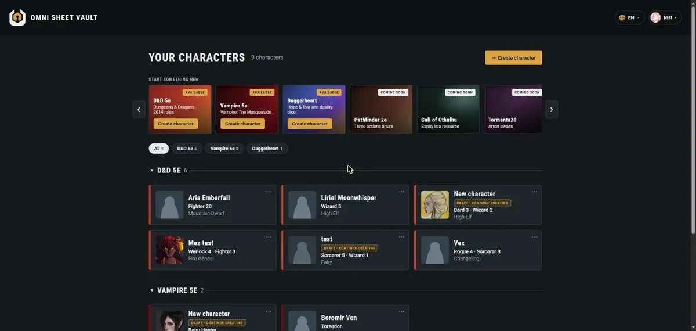
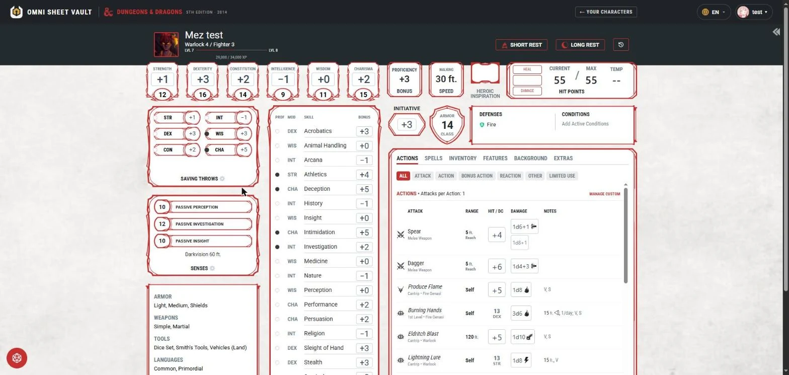
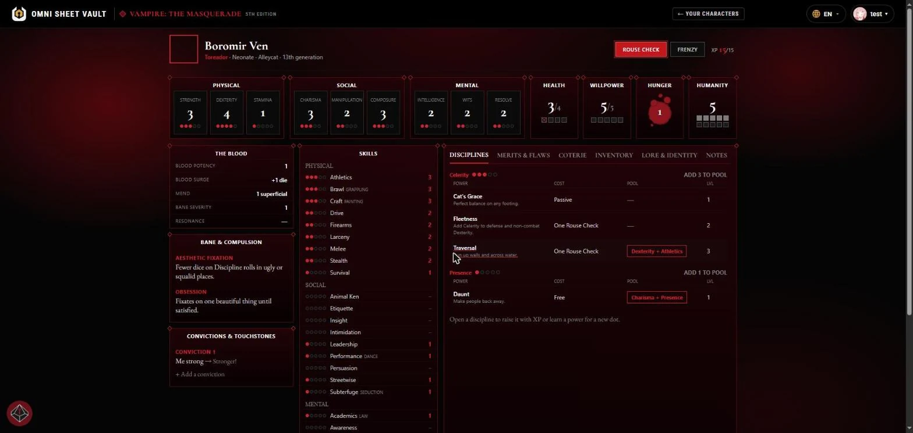
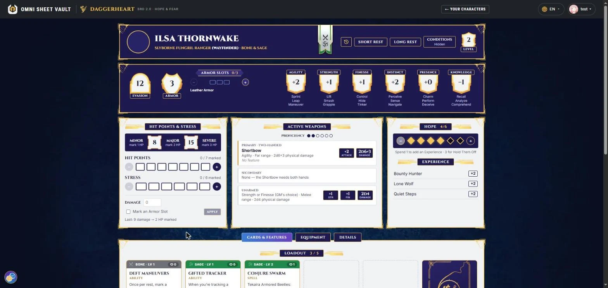

<div align="center">


# Omni Sheet Vault

**Every system. One vault for your heroes.**

Build characters with rules that explain every choice, play them on a sheet that knows<br>
its mechanics, and roll dice with a history nobody can fake. In English or Brazilian Portuguese.


<br>



</div>

> Single-system tools cover one game well. Generic tools treat sheets as forms with no
> mechanics behind them. Omni Sheet Vault aims for both: **system-aware mechanics** *and*
> **system plurality**.

---

## ✨ What it does

<table>
<tr>
<td width="50%" valign="top">

### 🧙 Guided creation
Every choice shows what it changes before you make it: ability scores, proficiencies, spells, hit points. The builder checks each system's rules (multiclass prerequisites, feat prerequisites, point buy), tracks what's still left to choose, and keeps the draft saved as you go.

### 📜 Sheets that play
Cast a spell, then roll its damage. Spend a slot, take a short or long rest, add a condition, mark Hunger or Stress: the sheet knows the mechanics behind each number. Level up from the sheet, with the new choices explained.

### 🎲 Honest dice
Dice are rolled on the server and kept in a permanent roll history that your table can check. Attacks, saves, checks, damage, critical hits, Hunger dice and Duality dice each roll the way their system says.

</td>
<td width="50%" valign="top">

### 🗃️ Your whole roster
Portraits, backstory and every character you play, across every game, in one place. Group and filter them by system, pick up a draft where you left it.

### 🌎 English & Brazilian Portuguese
The whole interface, the rules prompts and the game content in both languages, with feet turned into metres. Names follow the Brazilian books; switch languages from any page.

### 💻 Runs on your own PC
Besides the server edition, a Windows desktop edition bundles everything (Java, database and books) into one program: no account, no Docker, no internet needed to play.

</td>
</tr>
</table>

## 🎭 Game systems

| System | What you can do |
| --- | --- |
| **Dungeons & Dragons 5e** (2014 rules) | Full builder (species, classes and multiclassing, backgrounds, feats, equipment), a D&D Beyond–style sheet with actions, spells and inventory, level up, sheet themes, content from the 2014 books |
| **Vampire: The Masquerade 5e** | Builder with clans, predator types, disciplines and advantages; sheet with Hunger, Humanity, Willpower, Rouse Checks, frenzy and the coterie; Hunger dice |
| **Daggerheart** (SRD 2.0, incl. Hope & Fear) | Builder, sheet with domain cards and loadout, Hope, Stress and armor slots, Duality dice rolled on the server, level up 1–10 |
| Pathfinder 2e · Call of Cthulhu · Tormenta20 | Coming soon |

## 📸 A closer look

<div align="center">
<table>
<tr>
<td align="center" valign="top" width="50%">

<br><sub><b>Your characters</b> — every system in one vault</sub>
</td>
<td align="center" valign="top" width="50%">

<br><sub><b>D&D 5e</b> — a sheet that knows its rules</sub>
</td>
</tr>
<tr>
<td align="center" valign="top" width="50%">

<br><sub><b>Vampire 5e</b> — Hunger, Humanity and disciplines</sub>
</td>
<td align="center" valign="top" width="50%">

<br><sub><b>Daggerheart</b> — Hope, Stress and domain cards</sub>
</td>
</tr>
</table>
</div>

## 🛠️ Tech stack

| Layer | Tools |
| --- | --- |
| Backend | Java 25, Spring Boot, Spring Security, Flyway, Gradle |
| Frontend | React, TypeScript, Vite, Vitest |
| Data | PostgreSQL (characters, roll history, game catalogue), MinIO (portraits) |
| Identity | Keycloak (accounts and login, themed and translated); the API only validates tokens |
| Desktop edition | Embedded PostgreSQL, a trimmed Java runtime and a native Windows launcher built with `jpackage` |
| Quality | JUnit, Testcontainers, Vitest, GitHub Actions, SonarCloud |

## 🚀 Run it on your machine

### Requirements

- **JDK 25.** Gradle's toolchain finds it, so `JAVA_HOME` can point at another version.
- **Node.js** (LTS) and npm.
- **Docker** with Docker Compose, for PostgreSQL, Keycloak and MinIO.

### 1. Configure

```bash
git clone https://github.com/LydiaGarcia03/omni-sheet-vault.git
cd omni-sheet-vault
cp .env.example .env
```

Fill in `.env` with passwords of your choice. `KEYCLOAK_TEST_USERNAME` and
`KEYCLOAK_TEST_PASSWORD` create a ready-to-use player account. `.env` is git-ignored:
never commit it.

### 2. Start the infrastructure

```bash
docker compose up -d
```

| Service | Port |
| --- | --- |
| PostgreSQL | `5432` |
| Keycloak (login) | `8081` |
| MinIO API · console | `9000` · `9001` |

Keycloak imports the `omni-sheet-vault` realm on its first start.

### 3. Start the API

From the repository root (the Gradle build lives there; the API is the `:apps:api` subproject):

```bash
./gradlew :apps:api:bootRun        # Windows: .\gradlew.bat :apps:api:bootRun
```

The API listens on **`8090`**. Flyway creates the schema on the first start.

### 4. Load the game catalogue

The D&D and Daggerheart content lives in `content/`. Import each kind once (and again
whenever the content changes):

```powershell
# Windows PowerShell, from the repository root
Get-ChildItem content\dnd-5e -Directory |
  Where-Object { $_.Name -notin 'builds', 'mechanics' } |
  ForEach-Object { .\gradlew.bat :apps:api:bootRun --args="--import-catalogue=../../content/dnd-5e/$($_.Name) --server.port=0" }
```

Daggerheart works the same way with `content/daggerheart/<kind>`. The full steps are in
[`.ai/developer-guide.md`](.ai/developer-guide.md).

### 5. Start the web app

```bash
cd apps/web
npm install
npm run dev
```

Open **http://localhost:5173**, choose **Log in**, and sign in with your test account
(or create one).

### Tests

```bash
./gradlew :apps:api:check          # backend tests and checks (Testcontainers needs Docker)
cd apps/web && npm test            # frontend tests
```

## 💻 Build the desktop edition (runs alone on your PC)

The desktop edition packs the API, its libraries, the web app, the catalogue, an
embedded PostgreSQL and a trimmed Java runtime into one Windows program. Players need
no Java, no Docker and no account.

```powershell
.\gradlew.bat :apps:desktop:packageDesktop
```

It takes about a minute and produces:

```
apps\desktop\build\distributions\OmniSheetVault-<version>-windows.zip   (about 150 MB)
```

Extract the zip and double-click **`OmniSheetVault.exe`**. A small window starts the vault
and opens it in your browser at `http://localhost:8095/`. Characters are kept in
`%LOCALAPPDATA%\OmniSheetVault`, separate from the program, so updates keep them.

> Needs a full **JDK 25** (for `jpackage`) and runs the build on **Windows**, since
> `jpackage` builds for the system it runs on.

Installing, backing up, updating and troubleshooting are covered in the
[desktop edition guide](apps/desktop/README.md).

## 🗂️ Repository layout

```
omni-sheet-vault/
├── apps/
│   ├── api/        # Java 25 + Spring Boot backend (Gradle subproject :apps:api)
│   ├── desktop/    # Desktop launcher and Windows package (Gradle subproject :apps:desktop)
│   └── web/        # React + Vite frontend (independent npm project)
├── content/        # Game catalogue: D&D 5e (from 5etools) and Daggerheart (SRD 2.0)
├── infra/          # Keycloak realm and PostgreSQL first-boot scripts
├── tools/          # Content importers and translation tools
├── .ai/            # Project documentation: architecture, rules per system, decisions
└── docker-compose.yml
```

New to the code? Start with [`CLAUDE.md`](CLAUDE.md) and the [`.ai/`](.ai) index: architecture,
domain model, database schema, each game system's rules, and the decisions behind them.

## 📜 License and credits

Omni Sheet Vault is a non-commercial fan project. Its own code and art are under the
[PolyForm Noncommercial License 1.0.0](LICENSE.md).

Game names, rules and content belong to their owners:

- **Dungeons & Dragons** — unofficial Fan Content permitted under the Fan Content Policy;
  not approved or endorsed by Wizards of the Coast.
- **Vampire: The Masquerade** — an unofficial fan project, not approved or endorsed by
  Paradox Interactive. Vampire: The Masquerade and the World of Darkness are trademarks
  of Paradox Interactive AB.
- **Daggerheart** — content from the Daggerheart SRD 2.0 under the Darrington Press
  Community Gaming License.

Details and graphics credits are in [NOTICE.md](NOTICE.md).

<div align="center">
<br>
<sub>A personal project, built with the help of <a href="https://claude.ai">Claude</a>. 🦇</sub>
</div>
